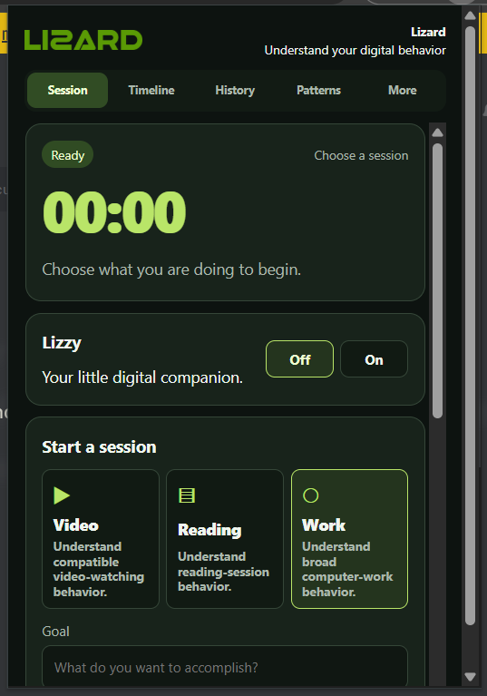
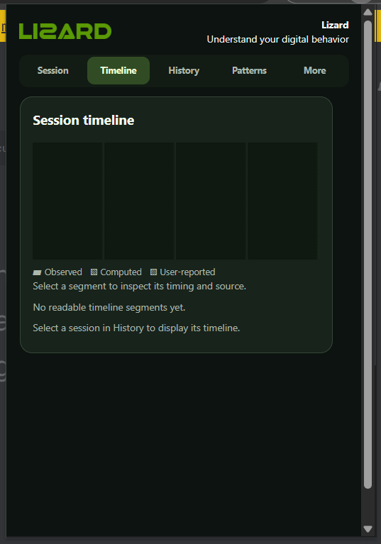
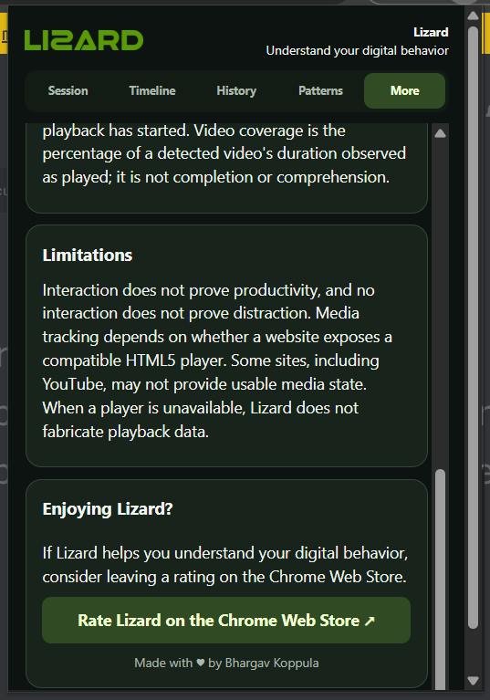
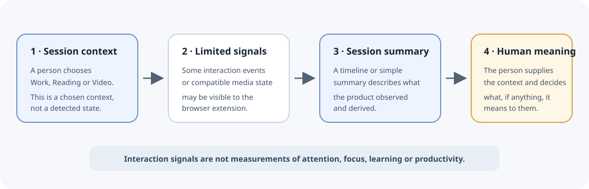

# Lizard — Behind the Build

*A project by Bhargav Koppula.*

**A journey into understanding how we spend our time on the internet.**

Lizard began with a simple question:

> “What if we could understand not just how long we spend online, but how we actually spend that time?”

What started as an experiment in focus tracking gradually evolved into a browser-based tool for reflecting on digital behaviour. This journal follows that path—the original idea, prototypes, experiments, decisions, missteps and lessons—without publishing the extension's implementation.

**The current Chrome Web Store package is version 3.3.1.** [View Lizard in the Chrome Web Store](https://chromewebstore.google.com/detail/lizard-%E2%80%94-personal-digital/inpclngnpklhenbjehpkhpanddgijlfi).

> **This repository is a project journal, not the extension source.** Lizard's extension source is maintained privately. See [Source access](SOURCE_ACCESS.md) for the request policy.

## Contents

- [The idea](#the-idea)
- [The journey](#the-journey)
- [The product](#the-product)
- [Experiments and decisions](#experiments-and-decisions)
- [Screenshots](#screenshots)
- [Known limitations](#known-limitations)
- [Future direction](#future-direction)
- [Source access](#source-access)
- [Project journal](#project-journal)

## The idea

A timer can show how long a session lasted, but not much about its shape. Lizard began as an attempt to make computer-session activity and quiet periods easier to notice. The project then had to confront an important limit: input is not attention. Quiet reading and thinking may involve little interaction; frequent interaction can happen while someone is distracted.

That distinction now shapes how the project describes itself. Lizard is an experimental reflection tool, not a cognitive-attention detector or a validated measure of productivity, learning or comprehension.

## The journey

The journal moves from an early focus-timer concept through prototypes, a browser-extension phase, new session categories and a more cautious product philosophy. It includes uncertainty where project records do not establish an exact date or prove that an idea shipped.

Start with [the original idea](journey/01-the-original-idea.md), then follow the [first prototype](journey/02-the-first-prototype.md), [experiments](journey/03-learning-from-experiments.md), [extension evolution](journey/04-the-chrome-extension.md), [the v2 development phase](journey/05-building-lizard-v2.md) and [the current product](journey/06-the-current-product.md).

## The product

Today Lizard offers Work, Reading and Video sessions, a timeline and history, simple summaries, and an optional companion character. These features organise observations for a person's own review; they do not reveal a person's mental state.

- [Product vision](product/product-vision.md)
- [Features and experience](product/features-and-experience.md)
- [Tracking philosophy](product/tracking-philosophy.md)
- [Known limitations](product/known-limitations.md)
- [Future direction](product/future-direction.md)

## Experiments and decisions

Lizard's development included interface revisions, reliability testing and cases where browser observations did not match what the team expected. The record distinguishes deterministic tests from hands-on browser checks; passing one is not proof of the other.

- [Design decisions](decisions/design-decisions.md)
- [Technical decisions](decisions/technical-decisions.md)
- [Lessons learned](decisions/lessons-learned.md)

## Screenshots

These are approved interface captures, not claims that every browser scenario works. Session and More show the current UI; the Timeline image is an empty state and contains no session history.

<figure>
  
  <figcaption>Ready Session view</figcaption>
</figure>

<figure>
  
  <figcaption>Timeline empty state</figcaption>
</figure>

<figure>
  
  <figcaption>More and limitations</figcaption>
</figure>

A conceptual—not implementation-level—view of the product's measurement boundary:

## Known limitations

Interaction and inactivity are only partial signals. People can think or read without interacting, interact while distracted, and encounter sites whose media player state is unavailable. The summaries and patterns are experimental and have not been validated as psychological or productivity measures.

See [known limitations](product/known-limitations.md) for detail. Historical browser tests also found Video scenarios where playback time remained at zero despite player discovery; publication does not erase that evidence.

## Future direction

Future research may explore whether transparent session summaries can support personal reflection while collecting as little as possible. These are questions to investigate—not promised features or validated conclusions. See [future direction](product/future-direction.md).

## Source access

The project journal is public, but the extension source is not included. Source review or collaboration requests are considered individually; details are in [SOURCE_ACCESS.md](SOURCE_ACCESS.md). Product comments and research/design conversations are welcome through [FEEDBACK.md](FEEDBACK.md).

## Project journal

- [Project overview](PROJECT_OVERVIEW.md)
- [Source access policy](SOURCE_ACCESS.md)
- [Feedback and discussion](FEEDBACK.md)

### Documentation and image rights

This repository is published without a separate licence for its prose or screenshots. Do not assume the MIT licence associated with the separate private source repository applies to these materials. This repository grants no general reuse permission beyond what applicable law allows.
